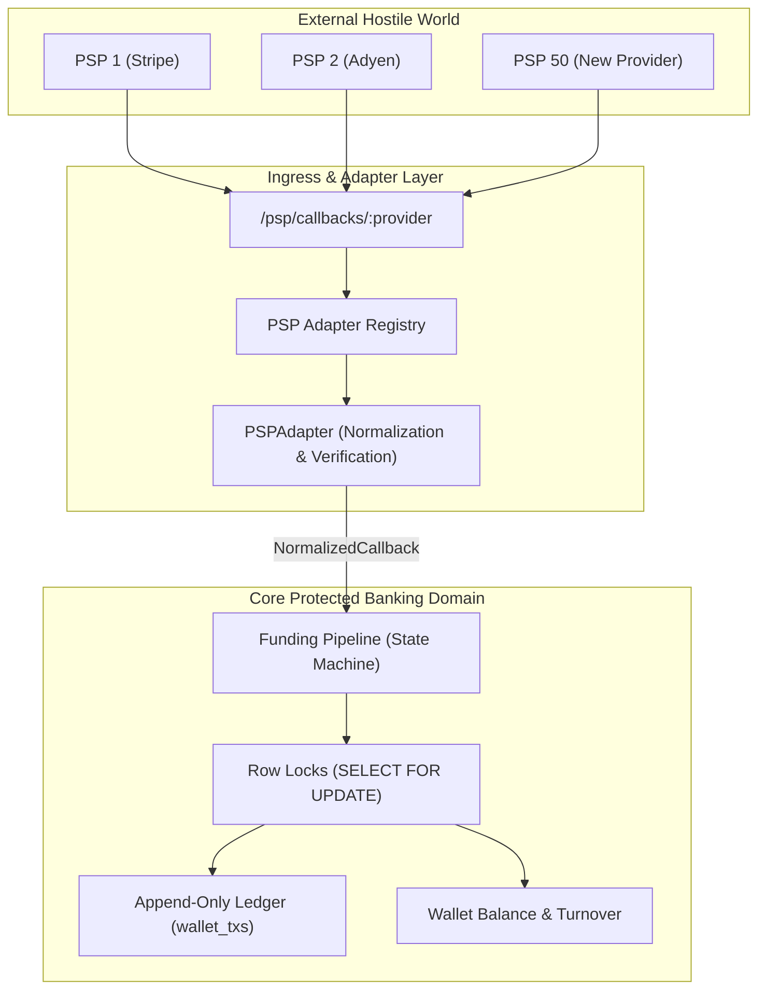

# System Design: Scaling to the 50th PSP (`DESIGN-PSP.md`)

## 1. Problem Context & Objectives
In a regulated real-money transactional platform, integrating dozens of external Payment Service Providers (PSPs) presents significant operational risks:
- Every PSP differs in signature schemes (HMAC-SHA256, RSA, shared secrets), payload formats (JSON, XML, URL-encoded), status vocabulary (`PAID`, `1`, `SUCCESS`, `APPROVED`), and currency units (minor units vs decimals).
- **Core Goal**: Structure the codebase such that integrating the 50th PSP is a **one-day task safely executed by a junior engineer**, without risk of touching or compromising core balance and ledger logic.

---

## 2. High-Level Architecture (Ports & Adapters)

I structured the design using **Hexagonal Architecture (Ports and Adapters)**. The core accounting engine, ledger, and state machine remain strictly isolated from external PSP eccentricities.



---

## 3. The `PSPAdapter` Contract Interface

Every provider implements a single, strongly-typed contract interface:

```typescript
export interface NormalizedCallback {
  internalPspRef: string;          // Internal reference (e.g. psp_dep_...)
  externalTransactionId: string;   // Provider's own transaction ID
  status: 'completed' | 'failed' | 'pending';
  amount: BigNumber;               // Normalized to standard major decimal units
  currency: string;                // ISO 4217 (e.g. 'EUR', 'USD')
  rawPayload: Record<string, unknown>;
}

export interface PSPAdapter {
  readonly providerName: string;

  /**
   * Cryptographically verifies inbound webhook signature against raw headers & body.
   */
  verifyWebhook(headers: Record<string, string>, rawBody: Buffer): Promise<boolean>;

  /**
   * Transforms provider-specific payload into standard domain model.
   * Handles minor-unit conversion (e.g. 10050 cents -> 100.50).
   */
  normalizeCallback(payload: unknown): NormalizedCallback;

  /**
   * Outbound initiation for deposits and withdrawals.
   */
  initiateDeposit(req: DepositInitRequest): Promise<DepositInitResponse>;
  initiateWithdrawal(req: WithdrawalInitRequest): Promise<WithdrawalInitResponse>;
}
```

---

## 4. Configuration-Driven Registry

Providers are registered in a centralized registry driven by environment configuration:

```typescript
// src/psp/registry.ts
export class PSPRegistry {
  private static adapters = new Map<string, PSPAdapter>();

  public static register(adapter: PSPAdapter): void {
    this.adapters.set(adapter.providerName.toLowerCase(), adapter);
  }

  public static get(provider: string): PSPAdapter {
    const adapter = this.adapters.get(provider.toLowerCase());
    if (!adapter) throw new NotFoundError(`Unsupported PSP provider: ${provider}`);
    return adapter;
  }
}
```

Dynamic routing entrypoint:
```typescript
// POST /psp/callbacks/:provider
pspRouter.post('/callbacks/:provider', async (req, res, next) => {
  const adapter = PSPRegistry.get(req.params.provider);
  
  const isValid = await adapter.verifyWebhook(req.headers as any, req.rawBody);
  if (!isValid) return res.status(401).json({ error: 'invalid_signature' });

  const normalized = adapter.normalizeCallback(req.body);

  // Hand off to immutable core funding pipeline
  const result = await fundingService.processCallback(normalized);
  return res.status(200).json(result);
});
```

---

## 5. The "Golden Path" for Junior Engineers

To integrate a new PSP in one day, a junior engineer only performs 3 steps:

1. **Create Adapter**: Implement `src/psp/adapters/<provider>Adapter.ts` adhering to `PSPAdapter`.
2. **Add Config Schema**: Define credentials in Zod config schema (`PSP_<NAME>_SECRET_KEY`, `PSP_<NAME>_API_URL`).
3. **Write Fixture Tests**: Add mock payloads to `test/fixtures/psp/<provider>/` and run the compliance test harness.

> **Crucial Guardrail**: A junior engineer **never touches** database transactions, `SELECT ... FOR UPDATE` row locks, balance calculation, or ledger insertions. These reside strictly inside the protected core domain.

---

## 6. Testing in CI Without Live External APIs

External PSP staging environments are notoriously unreliable, rate-limited, or inaccessible within automated CI/CD pipelines. I address this via a three-tier testing strategy:

### 6.1 Standard Compliance Test Harness (`runAdapterComplianceTests`)
I provide a parameterized test suite that every adapter must pass:
```typescript
// test/harness/complianceSuite.ts
export function runAdapterComplianceTests(adapter: PSPAdapter, fixtures: PSPFixtures) {
  describe(`PSP Compliance Suite: ${adapter.providerName}`, () => {
    it('verifies valid signature and rejects forged signature', async () => { ... });
    it('normalizes success callback into major decimal units', async () => { ... });
    it('normalizes failed callback correctly', async () => { ... });
    it('correctly maps currency minor units (e.g. cents/yen)', async () => { ... });
  });
}
```

### 6.2 Recorded Webhook Fixtures (Golden Files)
- Golden JSON/XML fixtures saved directly from provider sandbox documentation or test webhooks.
- Tests verify exact normalization against real-world sample bodies without any network I/O.

### 6.3 Deterministic HTTP Mocking (MSW / WireMock)
- Outbound API calls (e.g., `initiateDeposit`, `initiateWithdrawal`) are mocked in CI using `msw` (Mock Service Worker) or `nock`, matching request headers, signature generation, and endpoint paths deterministically.
